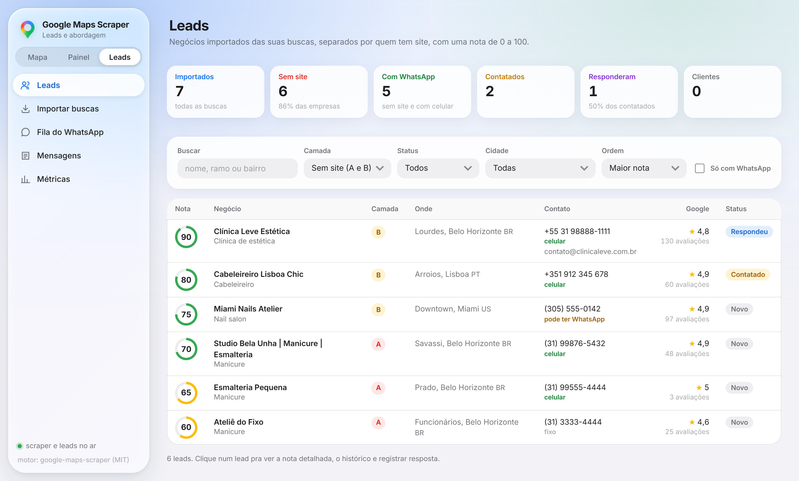
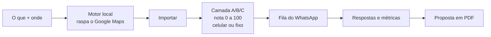
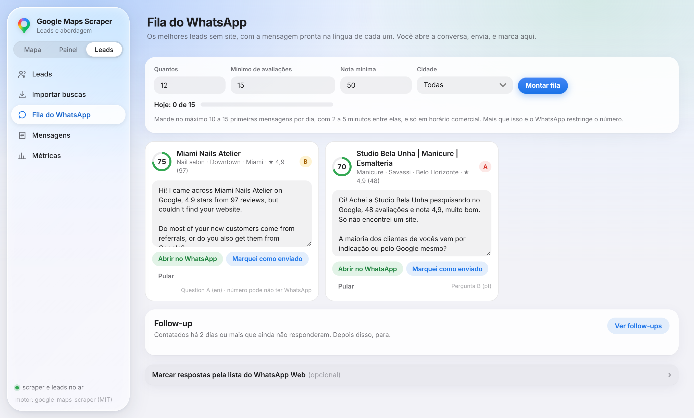

# SK Maps Scraper

**Raspa o Google Maps de graça, rodando na sua máquina, e transforma a lista em clientes.**

Sem API paga, sem crédito e sem limite por mês: o motor de raspagem roda num container Docker
no seu PC. Você busca "barbearia em Lisboa" e o SK Maps Scraper separa quem não tem site, dá
uma nota pra cada negócio, diz se o telefone é celular e monta a fila de WhatsApp com a
mensagem pronta.



## Como funciona



1. **Raspa.** No Mapa ou no Painel, você digita o tipo de negócio e o lugar. O motor abre o
   Google Maps no seu PC e coleta nome, telefone, site, nota, avaliações, endereço e e-mail.
2. **Qualifica.** Em Leads, você importa a busca. Cada negócio ganha uma camada e uma nota de
   0 a 100, e o telefone é lido pelas regras do país dele.

   | Camada | O que tem no Google | Leitura |
   |---|---|---|
   | **A** | nada | invisível online |
   | **B** | só Instagram, linktree, WhatsApp ou página de agendamento (Booksy, Square, Vagaro...) | tem público, não tem site |
   | **C** | site próprio | sai da fila |

3. **Aborda.** A fila mostra os melhores leads sem site, com a mensagem na língua de cada um
   (português, espanhol ou inglês). Você abre o WhatsApp com o texto pronto e envia.
4. **Mede e fecha.** Registra as respostas (resposta automática não conta), vê qual mensagem
   responde mais e gera a proposta em PDF com os dados reais do lead.

Reimportar uma busca só atualiza os dados do Google. Status, notas e histórico ficam.



## Começar

Precisa do [Docker Desktop](https://www.docker.com/products/docker-desktop).

```bash
git clone https://github.com/screm1n/sk-maps-scraper.git
```

```bash
cd sk-maps-scraper
```

```bash
docker compose up -d --build
```

Abre em **http://localhost:8080**. Mapa e Painel pra raspar, **Leads** pra qualificar e abordar.

Quer ver as telas antes de instalar o Docker? Com Node 22.13 ou mais novo, um scraper de
exemplo faz o papel do motor:

```bash
cd leads && npm install && node test/scraper-falso.js
```

E, em outro terminal:

```bash
cd leads && npm start
```

Abre em http://localhost:3000/leads.

Com o [Claude Code](https://claude.com/claude-code) aberto na pasta, dá pra pedir em português
mesmo: *"raspa dentistas em Curitiba"*. Também tem os comandos `/scrape`, `/scrape-batch`,
`/scrape-setup` e `/scrape-jobs`. O passo a passo detalhado está no [SETUP.md](SETUP.md).

## As telas

| Tela | Pra quê |
|---|---|
| **Mapa** e **Painel** | Criar buscas, acompanhar e ver os resultados no mapa ou em tabela |
| **Leads** | Lista com camada, nota e tipo de telefone. Clique num lead pra ver de onde vem a nota, registrar resposta e gerar proposta |
| **Importar buscas** | Transforma uma busca terminada em leads |
| **Fila do WhatsApp** | Mensagens prontas, follow-up de 48h e o medidor de envios do dia |
| **Mensagens** | Seus textos com `{{nome}}`, `{{nota}}`, `{{qtd_avaliacoes}}`, com checagem ao vivo |
| **Métricas** | Funil e taxa de resposta por mensagem |

## Use com cuidado

- **Raspar o Google Maps vai contra os termos do Google.** Faça uma busca por vez e comece
  com profundidade baixa. Exagerar bloqueia seu IP por algumas horas (sua conta Google não é
  afetada). Pra volume grande, use proxies.
- **Mensagem fria é tratamento de dado pessoal** (LGPD no Brasil, RGPD na Europa). Mande no
  máximo 10 a 15 primeiras mensagens por dia, com minutos entre elas, sempre com uma saída, e
  bloqueie quem pedir pra parar. Nos EUA, SMS frio é proibido por lei.

## Por dentro

```
docker-compose.yml   motor de raspagem + servidor de leads + nginx na porta 8080
frontend/            telas: Mapa, Painel, Leads e Proposta
leads/               servidor de leads: Node 22, SQLite embutido, uma dependência
  src/dominio/       as regras: camadas, nota, telefone, mensagens, respostas automáticas
  test/              npm test (regras e fluxo completo) e o scraper de exemplo
scripts/             scrape.py e scrape.sh pra raspar pela linha de comando
.claude/             skill e comandos pro Claude Code
```

Os dados ficam no seu PC: as buscas no volume `gmaps_data` e os leads no volume `leads_data`.
`docker compose down -v` apaga tudo.

## Créditos

- **Motor de raspagem:** [google-maps-scraper](https://github.com/gosom/google-maps-scraper),
  de **Georgios Komninos** ([@gosom](https://github.com/gosom)), licença MIT. É ele que faz a
  raspagem de verdade. Se o projeto te ajudou, deixa uma ⭐ no repositório dele.
- **Base do kit** (Docker, scripts, Mapa e Painel): Google Maps Scraper Kit, de Mahan
  ([@mahanjafari-dev](https://github.com/mahanjafari-dev)) e Felipe Nunes
  ([@felipenunes07](https://github.com/felipenunes07)), licença MIT.
- Licenças completas em [LICENSE](LICENSE) e [CREDITS.md](CREDITS.md).
